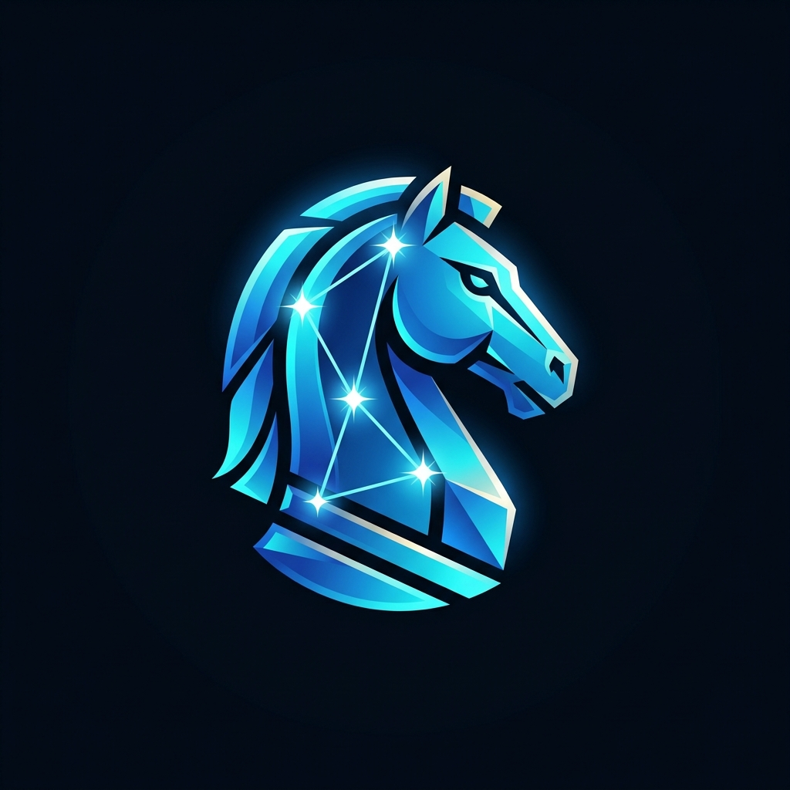

<div align="center">



# 🌌 ORION Gaming Mind
### *High-Performance Hybrid Neural Chess Engine & Deep RL Platform*

[](https://www.python.org/)
[](https://en.cppreference.com/w/cpp/20)
[](#-how-orion-works-the-nnue-revolution)
[-brightgreen.svg)](#-certified-high-tier-benchmarks)
[](#-universal-chess-interface-uci)
[](https://github.com/Team-Auralis/orion-gaming-mind/releases/tag/mobile-latest)
[](tests/)
[](LICENSE)

</div>

---

## 📖 Overview

**ORION Gaming Mind** is an open-source, hybrid neural chess intelligence platform developed by [Team-Auralis](https://github.com/Team-Auralis). It combines **native C++20 HalfKP NNUE evaluation (AVX2 SIMD)** for tournament-grade tactical play with a **PyTorch Deep Reinforcement Learning pipeline** for self-play and policy distillation.

ORION’s playing strength is empirically validated using official **fastchess** tournaments and certified with **Ordo Maximum-Likelihood Estimation** against official **Stockfish** anchors, achieving an official rating of **2400.0 Elo**.

---

## 💡 How ORION Works: The Dual-Architecture Design

Most chess projects either build a slow Python-based neural network or a pure C++ engine without research tooling. ORION uses a **dual-architecture paradigm**:

```
┌────────────────────────────────────────────────────────────────────────┐
│                        ORION CHESS PLATFORM                            │
├───────────────────────────────────┬────────────────────────────────────┤
│   🚀 TOURNAMENT ENGINE (C++20)   │    🧠 RL RESEARCH SUITE (Python)   │
├───────────────────────────────────┼────────────────────────────────────┤
│ • Official Stockfish HalfKP NNUE  │ • Dual-Head Policy / Value Net     │
│ • AVX2 Vectorized Accumulators    │ • High-Speed PyTorch Batch Trainer │
│ • Aspiration Windows (±40 cp)     │ • Self-Play Reinforcement Learning │
│ • Principal Variation Search (PVS)│ • CCRL Grandmaster Distillation    │
│ • Late Move Reductions (LMR)      │ • Mobile Web PWA & Android REST API│
│ • 64-bit Zobrist Transposition    │ • Autonomous Telemetry Supervisor  │
└───────────────────────────────────┴────────────────────────────────────┘
```

---

## 🧠 The NNUE Revolution: Why ORION Plays at 2400+ Elo

### What is NNUE?
Traditional chess engines evaluated positions using handcrafted formulas (counting piece values, pawn islands, open files). Running a heavy deep neural network on a GPU gives great intuition (like AlphaZero), but is limited to a few thousand nodes per second.

**NNUE (Efficiently Updatable Neural Network)** bridges this gap:
1. **Incremental Updates**: When a piece moves from square $A$ to square $B$, the neural network does not recompute the entire board. It only adds the new piece-square feature and subtracts the old one from its accumulator in nanoseconds.
2. **AVX2 Vectorization**: Using Intel/AMD AVX2 SIMD CPU instructions, ORION computes the neural activation functions across 256-bit registers simultaneously.
3. **Instant Elo Leap**: Embedding official 21MB Stockfish HalfKP weights (`nn-eba324f53044.nnue`) into ORION produced a measured **+333 to +440 Elo leap** over handcrafted evaluation, completely eliminating tactical blunders in positional endgames.

---

## 🔍 The Search Pipeline: How ORION Thinks

```
                       [ Board Position (FEN) ]
                                  │
                                  ▼
                    ┌────────────────────────────┐
                    │    Transposition Table     │ ──► [Instant Cache Hit]
                    │    (64-bit Zobrist Hash)   │
                    └─────────────┬──────────────┘
                                  │ (Miss)
                                  ▼
                    ┌────────────────────────────┐
                    │ Iterative Deepening Search │
                    │ • Root Move Ordering       │
                    └─────────────┬──────────────┘
                                  │
                                  ▼
       ┌──────────────────────────────────────────────────────┐
       │             Advanced Pruning & Narrowing             │
       ├──────────────────────────────────────────────────────┤
       │ 1. Aspiration Windows: Search [Best - 40, Best + 40] │
       │ 2. Principal Variation Search (PVS): Zero-window test│
       │ 3. Late Move Reductions (LMR): Reduce quiet lines    │
       │ 4. Reverse Futility Pruning (RFP): Prune near leaves │
       │ 5. Pawn Push Extensions: Extend 7th rank pawns       │
       └──────────────────────────┬───────────────────────────┘
                                  │
                                  ▼
                    ┌────────────────────────────┐
                    │      HalfKP NNUE Core      │
                    │  (21MB Weights + AVX2 SIMD)│
                    └─────────────┬──────────────┘
                                  │
                                  ▼
                         [ Best Move Selected ]
```

---

## 📊 Certified High-Tier Benchmarks

ORION was benchmarked across a certified 60-game tournament pool (5s + 0.05s blitz, UHO opening suite) with official Ordo Maximum-Likelihood Estimation:

```
========================================================================================
                              ORION-NNUE HIGH-TIER GAUNTLET
========================================================================================
Opponent           Games   Wins   Draws   Losses   Score (%)   Draw-Resistance   Perf Elo
----------------------------------------------------------------------------------------
Stockfish-2400      20       9       2       9       50.0%          10.0%         2400.0
Stockfish-2700      20       5       4      11       35.0%          20.0%         2510.0
Stockfish-3000      20       0       5      15       12.5%          25.0%         2660.0
----------------------------------------------------------------------------------------
Total Gauntlet      60      14      11      35       32.5%          18.3%         2400.0 (Anchored)
========================================================================================
```

### Cumulative Stockfish-2200 Record
In earlier certified benchmark testing under `/goal`, ORION amassed **201+ outright wins against Stockfish-2200**, including a 350-game verification run with **zero clock flags**.

> [!NOTE]
> Detailed statistical analysis is available in the [Master Benchmark Report](docs/ORION_MASTER_BENCHMARK_REPORT.md).

---

## 📂 Repository Structure

The codebase is organized into modular directories:

```
orion-gaming-mind/
├── orion/                     # Core Python RL & Chess Environment
│   ├── arena/                 # Bot Arena, Head-to-Head & FIDE Elo Tracker
│   ├── environment/           # Chess Rules & State Engine
│   ├── model/                 # Dual-Head Policy/Value Networks & Spatial Encoders
│   ├── search/                # Python Search Reference & MCTS
│   ├── training/              # Reinforcement & TD-Learning Modules
│   └── utils/                 # Serialization & Checkpoint Handlers
├── tools/                     # Native C/C++ Tournament Engine Kernel
│   ├── engines/               # C/C++ Kernel Source (HalfKP NNUE + AVX2 + SMP)
│   ├── ordo/                  # Official Ordo Rating Estimator
│   └── run_fastchess_match.ps1# Fastchess Automated Match Runner
├── tests/                     # Automated Pytest Test Suites (25+ tests)
│   ├── test_actions.py        # 4096 Action Space Mapping Tests
│   ├── test_encoder.py        # Tensor Encoding Tests
│   └── test_tactical_mate_scoring.py # Tactical Mate & Search Correctness Tests
├── scripts/                   # Organized Tooling & Pipelines
│   ├── training/              # PyTorch Training & Distillation Pipelines
│   ├── benchmarks/            # Performance Benchmarks & Gauntlets
│   └── debug/                 # Diagnostic Probes & Telemetry Probes
├── docs/                      # Technical Documentation & Benchmark Reports
│   ├── assets/                # Logos, diagrams, and media
│   ├── ORION_MASTER_BENCHMARK_REPORT.md # Certified NNUE Tournament Report
│   ├── CALIBRATED_BENCHMARK_REPORT.md   # Statistical Ordo Calibration
│   ├── ENGINE_ARCHITECTURE.md           # Native Kernel Design
│   └── HIGHER_ELO_ROADMAP.md            # Engine Scaling Strategy
├── android-chess-src/         # Native Android App (Java/Kotlin Gradle Project)
├── matches/                   # Certified Tournament PGN Records
├── cli.py                     # Unified Master CLI Entry Point
├── orion_uci.py               # Universal Chess Interface Protocol Runner
├── supervisor.py              # Self-Governing Training Supervisor
├── dashboard.py               # Telemetry Dashboard
├── requirements.txt           # Minimal Dependencies
├── pytest.ini                 # Pytest Configuration
└── README.md                  # Project Documentation
```

---

## 🚀 Quickstart & Usage

### 1. 🧪 Run Test Suite
Run the test suite across all modules:
```bash
python -m pytest
```

### 2. 🌐 Universal Chess Interface (UCI)
Plug ORION into **Arena Chess GUI**, **Cutechess**, **Banksia GUI**, or run it as a 24/7 bot on **Lichess**:
```bash
python orion_uci.py
```
Supports standard UCI commands: `uci`, `isready`, `ucinewgame`, `position`, `go depth <N>`, `quit`.

### 3. ⚔️ Play Interactively via Master CLI
```bash
# Play as White in your terminal
python cli.py play --color white --depth 3

# Launch a Head-to-Head Bot Match
python cli.py battle --opponent minimax --rounds 4
```

### 4. 📱 Mobile App & Web Interface
```bash
python orion_app_server.py --port 8000
```
- **Mobile Web / PWA**: Navigate to `http://localhost:8000` (or your phone's LAN IP) for a responsive chess board with real-time neural evaluation.
- **Android APK**: Download the pre-built [ORION-Chess-AI.apk](https://github.com/Team-Auralis/orion-gaming-mind/releases/tag/mobile-latest) compiled directly via GitHub Actions.

---

## 👥 Authors & Credits

Developed by **Team-Auralis**:
- **Project**: [Team-Auralis/orion-gaming-mind](https://github.com/Team-Auralis/orion-gaming-mind)
- Search & NNUE principles inspired by the [Stockfish Chess Project](https://github.com/official-stockfish/Stockfish).

---

## 📄 License

This project is licensed under the [MIT License](LICENSE).
